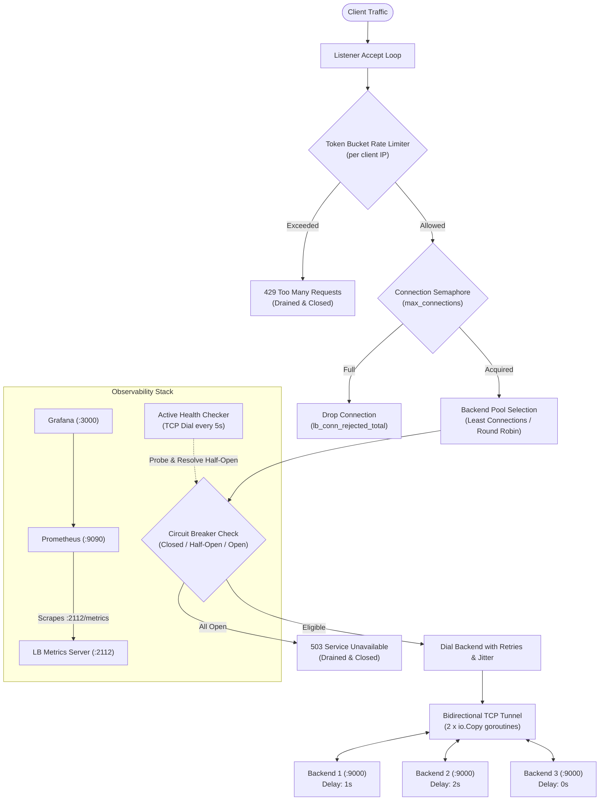
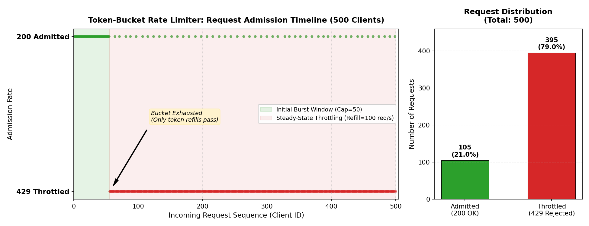
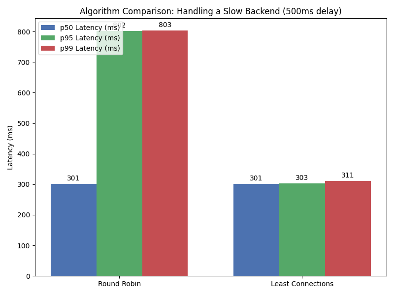
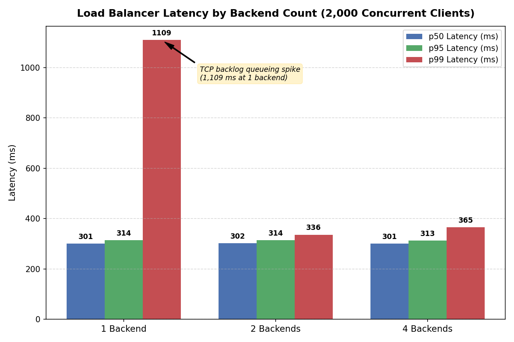
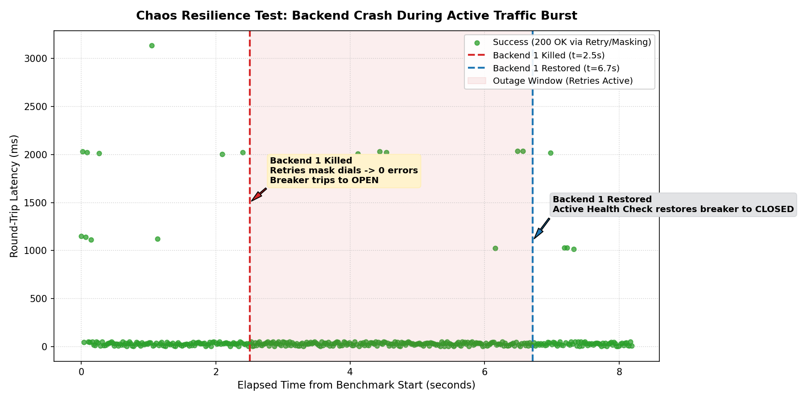

# Layer 4 (TCP) Load Balancer in Go

A concurrent, resilient Layer 4 (TCP) load balancer written from scratch in Go using standard library primitives (`net`, `sync`, `io`). Built without high-level HTTP reverse proxy packages, this project explores core distributed systems patterns: socket multiplexing, least-connections scheduling, token-bucket rate limiting, circuit breaking with failure attribution, jittered retries, and comprehensive Prometheus/Grafana observability.

---

## Architecture Overview



---

## Core Features & Mechanics

### 1. Bidirectional TCP Socket Tunneling
- Streams data between client and backend connections concurrently using two `io.Copy` goroutines.
- Wrapped in custom `idleConn` decorators with per-read/write deadlines to prevent hung or zombie connections from holding memory indefinitely.
- Half-closes TCP writes (`CloseWrite()`) upon receiving `EOF` to ensure clean TCP connection termination in both directions.

### 2. IP-Based Token-Bucket Rate Limiter
- Implements a thread-safe token bucket algorithm (`requests_per_sec` fill rate with `burst_cap` allowance) keyed by client IP.
- Features a periodic background cleaner (runs every 5 minutes) that evicts idle client entries older than 10 minutes to bound memory usage.
- **RST Prevention:** Rejections return an `HTTP/1.1 429 Too Many Requests` response followed by a deadline-bounded drain (`io.Copy(io.Discard, ...)`) before closing, preventing TCP `RST` packets from wiping out unread client buffers.

### 3. Stateful Circuit Breaker with Failure Attribution
- Backends transition through three states: **Closed** (normal), **Open** (tripped on `max_failures`), and **Half-Open** (probing for recovery after `cooldown`).
- **Backend Failure Attribution (`trackedConn`):** Wraps the backend connection to track Read/Write errors specifically on the backend leg. If a client disconnects prematurely or times out, the backend is **not** penalized.
- **Straggler Guard:** `RecordSuccess` rejects responses from old in-flight connections if the circuit breaker was subsequently tripped back to `Open`.
- **Health-Check Resolution:** A passing active TCP health check can safely reset a `Half-Open` breaker to `Closed`, ensuring long-lived TCP sessions do not block recovery.

### 4. Connection Retries with Exponential Jittered Backoff
- Failed backend connection attempts back off exponentially (`initial_backoff * 2^attempt`) with 20% random jitter to mitigate thundering herd problems.
- Context-aware: aborts retry sleep loops immediately during graceful server shutdown.

### 5. Graceful Shutdown
- Catches `os.Interrupt` and `syscall.SIGTERM`.
- Closes the TCP listener to stop accepting new requests, then allows active in-flight transfers up to 30 seconds to complete gracefully before force-closing remaining active sockets.

### 6. Full Prometheus & Grafana Observability
- Exposes Prometheus metrics on `:2112/metrics` with hardened HTTP server timeouts (`ReadHeaderTimeout: 3s`, `ReadTimeout: 5s`, `WriteTimeout: 5s`, `IdleTimeout: 30s`) and graceful context-bounded draining on shutdown.
- Exposes a real-time JSON snapshot on `:2112/status` detailing backend health, active connection distribution, and breaker states.
- **Pre-provisioned 8-Panel Grafana Dashboard (`dashboard.json`, schema v39):**

| Panel | Metric / PromQL | Visualization & Purpose |
|---|---|---|
| **Active Connections** | `lb_active_connections` | Real-time concurrent in-flight TCP connections per backend. |
| **Request Rate** | `sum by (backend, status) (rate(lb_req_total[10s]))` | Throughput (req/s) partitioned by backend target and response status. |
| **Latency p95** | `histogram_quantile(0.95, sum by (le, backend) (rate(lb_req_duration_seconds_bucket[30s])))` | 95th percentile latency curves per backend leg in seconds. |
| **Healthy Backends** | `sum(lb_backend_health)` | Instant stat gauge showing active TCP health-checked backends (3 = all healthy). |
| **Rate Limited (req/s)** | `rate(lb_rate_limited_total[10s])` | Timeseries tracking 429 rate limiter rejection velocity. |
| **Circuit Breaker State** | `lb_cb_state` | State tracker: `0: Closed` (green), `1: Half-Open` (yellow probe), `2: Open` (red tripped). |
| **Connections Rejected** | `sum by (reason) (rate(lb_conn_rejected_total[10s]))` | Rejection breakdown by trigger: `rate_limited`, `connection_limit`, `no_backend`. |
| **Retries (per second)** | `sum by (backend) (rate(lb_retries_total[10s]))` | Exponential retry frequency per backend during node downtime or transient dial faults. |

---

## Project Structure

```text
.
├── cmd/
│   ├── loadbalancer/   # Load balancer entrypoint & accept loop
│   ├── backend/        # Raw TCP test backend with artificial delay & jitter
│   └── loadtest/       # High-concurrency benchmark generator with percentile metrics
├── internal/
│   ├── config/         # YAML config parsing, strict KnownFields validation & duration parsing
│   ├── pool/           # Backend pool, load balancing algorithms & circuit breaker logic
│   └── proxy/          # Token-bucket rate limiter, tracked socket tunneling & retries
├── grafana/
│   ├── dashboards/     # Pre-provisioned Grafana dashboard (JSON schema v39)
│   └── provisioning/   # Automated datasources & dashboard provider setup
├── prometheus/         # Prometheus scraper configuration
├── plots/              # Benchmark results, comparison plots, and visualization scripts
├── config.yaml         # Load balancer runtime configuration
└── docker-compose.yml  # Multi-container local deployment
```

---

## Getting Started

### Prerequisites
* Docker & Docker Compose
* Go 1.24+ (if compiling or testing locally; repo uses Go 1.26 toolchain)

### Running the Stack

Boot the complete cluster (Load Balancer, 3 backends with varying latency, Prometheus, and Grafana):

```bash
docker compose up --build -d
```

### Endpoints

| Service | Address | Description |
|---|---|---|
| **Load Balancer** | `localhost:8080` | Client traffic entrypoint |
| **Observability Status** | `http://localhost:2112/status` | Real-time JSON snapshot of pool health & breakers |
| **Prometheus Metrics** | `http://localhost:2112/metrics` | Raw Prometheus exposition endpoint |
| **Prometheus UI** | `http://localhost:9090` | Prometheus web console |
| **Grafana Dashboard** | `http://localhost:3000` | Auto-provisioned dashboard (Anonymous Admin enabled for demo) |

> **Note on Grafana Authentication:** Anonymous Admin access (`GF_AUTH_ANONYMOUS_ENABLED=true`) is configured strictly for rapid local testing and interview demonstration. For production deployment, disable anonymous access and configure authenticated user roles.

---

## Configuration Reference (`config.yaml`)

```yaml
server:
  listen_address: "0.0.0.0:8080"
  max_connections: 500

load_balancer:
  algorithm: "least_connections" # Options: least_connections, round_robin
  connection_timeout: "1s"

health_check:
  enabled: true
  timeout: "1s"
  interval: "5s"

rate_limit:
  requests_per_sec: 100
  burst_cap: 50

circuit_breaker:
  max_failures: 3
  cooldown: "5s"

retry:
  max_retries: 3
  initial_backoff: "100ms"

idle_timeout: 60s

backends:
  - "backend1:9000"
  - "backend2:9000"
  - "backend3:9000"
```

*All durations are strictly validated at startup. Unknown configuration keys fail loudly via `yaml.Decoder.KnownFields(true)`.*

---

## Benchmarks & Empirical Performance

### Load Test Execution

Run the concurrent load generator from inside the Docker network:

```bash
docker compose --profile bench run --rm loadtest
```

### Rate Limiting & Latency Profile (500 Concurrent Clients)

With `requests_per_sec: 100` and `burst_cap: 50` targeting asymmetric backends (`backend1`: 1s delay, `backend2`: 2s delay, `backend3`: 0s delay):

```text
Starting benchmark: 500 clients, 1024 byte payload, targeting lb:8080

--- Benchmark Summary ---
Total Requests: 500
Successes:      133
Failures:       367
  - Rate Limited (429): 367
  - Unavailable (503):  0
  - Timeouts:           0
  - Connection Resets:  0
  - Dial Errors:        0
p50 Latency:    35.00 ms
p95 Latency:    2038.00 ms
p99 Latency:    2055.00 ms

Raw results written to benchmark_results.csv
```

- **Rate Limiting Dynamics:** The token bucket admits the initial burst (capacity = 50 + refill during rampup), after which the bucket is exhausted. Incoming requests are then rejected with `HTTP 429 Too Many Requests`, admitting only periodic requests as tokens regenerate at 100 tokens/sec.
- **Latency Distribution:** Under Least Connections, fast requests route to `backend3` (yielding p50 of ~35ms), while remaining long requests queue across `backend1` (1s) and `backend2` (2s), reflected accurately in the p95 and p99 percentiles.



---

### Algorithm Comparison: Least Connections vs. Round Robin

When an asymmetric slow backend is introduced (e.g. 500ms latency penalty), Round Robin blindly routes traffic evenly, causing tail latency to balloon. Least Connections dynamically sheds load away from slow backends:

| Metric | Round Robin | Least Connections | Improvement |
|---|---|---|---|
| **p50 Latency** | 301 ms | 301 ms | Parity |
| **p95 Latency** | 802 ms | 303 ms | **~62% reduction** |
| **p99 Latency** | 803 ms | 311 ms | **~61% reduction** |



---

### Scaling Under High Concurrency (2,000 Concurrent Connections)

Tested across client scales without rate limiting:

| Concurrency | 1 Backend (p50 / p95 / p99) | 2 Backends (p50 / p95 / p99) | 4 Backends (p50 / p95 / p99) | Success Rate |
|---|---|---|---|---|
| **10 clients** | 304ms / 317ms / 317ms | 305ms / 318ms / 318ms | 304ms / 318ms / 318ms | 100% |
| **100 clients** | 302ms / 304ms / 316ms | 302ms / 308ms / 319ms | 302ms / 305ms / 319ms | 100% |
| **500 clients** | 301ms / 305ms / 314ms | 302ms / 321ms / 343ms | 301ms / 304ms / 313ms | 100% |
| **2000 clients** | 301ms / 314ms / 1109ms | 302ms / 314ms / 336ms | 301ms / 313ms / 365ms | 100% |



*Note: At 2,000 concurrent clients on a single backend, p99 reaches ~1.1s due to TCP listen backlog queueing under burst dial conditions; distributing across 2+ backends eliminates this tail latency spike.*

---

### Chaos Fault-Tolerance: Zero-Downtime Backend Failure & Recovery

To empirically test resilience, we executed an automated chaos test (`run_chaos_test.py`) with 400 concurrent clients:
1. **t = 2.5s (Fault Injection):** `backend1` container was forcibly stopped mid-traffic.
2. **Circuit Breaking & Masking:** Immediate dial failures were intercepted by the jittered retry engine and redirected to healthy backends. The circuit breaker recorded consecutive failures and tripped `backend1` to `OPEN`, preventing subsequent requests from attempting to dial the dead container.
3. **t = 6.7s (Recovery):** `backend1` was restarted. Active TCP health checks detected service restoration and seamlessly transitioned the breaker back to `CLOSED`.

```text
=== Chaos Test Summary (400 Clients under Live Node Failure) ===
Total Requests: 400
Successes:      400 (100.0% Success Rate)
Failures:       0   (Zero Dropped Requests)
p50 Latency:    31.00 ms
p95 Latency:    1017.00 ms
p99 Latency:    2033.00 ms
```



*All 400 requests completed successfully. In-flight connections caught during the kill event were masked by exponential retries, resulting in zero user-visible errors.*

---

## Design Decisions & Trade-offs

| Decision | Approach Chosen | Rationale & Trade-off |
|---|---|---|
| **Layer 4 vs. Layer 7** | Raw TCP socket proxying (`net.Conn`) | **Pro:** Protocol-agnostic, low memory footprint, high throughput without HTTP header parsing overhead.<br>**Con:** Cannot inspect HTTP request headers, paths, cookies, or host headers for routing. |
| **Deadlines vs. Zero-Copy Splice** | Custom `idleConn` wrapper with deadlines | **Pro:** Prevents idle/dead connections from leaking goroutines and file descriptors permanently.<br>**Con:** Wrapping `net.Conn` prevents the Linux runtime from applying kernel-level `splice()` zero-copy optimizations. |
| **Circuit Breaker Attribution** | Explicit `trackedConn` on backend leg | **Pro:** Client disconnects and network resets are accurately isolated, avoiding false positive breaker trips on healthy backends.<br>**Con:** Small wrapper overhead tracking per-connection read/write errors. |
| **Half-Open Resolution** | Active health check + probe completion | **Pro:** In-flight probes do not stay stuck in half-open state during long-lived TCP sessions, and health checks unblock recovery without sacrificing user requests.<br>**Con:** Health check frequency (e.g. 5s) dictates the minimum recovery resolution window. |

---

## Verification & Testing

Run unit and integration tests:

```bash
# Run tests across all internal packages
go test -v ./internal/...

# Run with race detector
go test -race ./internal/...
```
